# 🧠 GraphRAG Knowledge Assistant

A local-first demo of **GraphRAG**: turn text into a knowledge graph, then ask questions using a local language model. The app combines **Streamlit**, **Neo4j**, and **Ollama** to show connected facts and source references.

> **In a hurry?** If Docker Desktop is installed and running, start with [Run with Docker Compose](#-run-with-docker-compose). You do not need to install Python, Neo4j, or Ollama separately for that option.

## ✨ What you can do

- 📄 Enter text or try one of the built-in sample documents.
- 🧩 Use Ollama to extract entities and relationships from the text.
- 🕸️ Save the extracted graph in Neo4j.
- 🔎 Ask questions and expand matching graph nodes to nearby connected nodes.
- 💬 Generate an answer with inline citation markers and see retrieval steps.
- 📊 View graph node/relationship counts or clear the connected graph.

## 🧰 Technology

| Component | Role |
|---|---|
| Streamlit | Web interface |
| Neo4j 5+ | Stores entities and their relationships |
| Ollama | Runs the local language model |
| Python 3.11+ | Runs the app |
| Docker Compose | Optional: starts the app and services together |

## 🚀 Run with Docker Compose

### Prerequisites

- Docker Desktop installed and running with the **Linux container engine**.
- At least a few GB of free disk space for the images and `llama3.2` model.

### Start the app

Open PowerShell in this project folder and run:

```powershell
docker compose up --build -d
```

Compose starts three services:

1. **Neo4j** — graph database
2. **Ollama** — downloads and serves the `llama3.2` model
3. **Streamlit** — the web app

The first start can take a few minutes while Docker downloads the images and Ollama downloads the model. The app container may start before Ollama finishes downloading, so wait for the model before trying an AI action.

Check the model download:

```powershell
docker compose logs -f ollama
```

When you are done watching the logs, press **Ctrl+C**. This stops log-following, not the containers. To confirm that the model is installed:

```powershell
docker compose exec ollama ollama list
```

### Open and configure the app

- **Streamlit app:** [http://localhost:8501](http://localhost:8501)
- **Neo4j Browser:** [http://localhost:7474](http://localhost:7474)

In the Streamlit sidebar, use:

| Setting | Docker Compose value |
|---|---|
| Neo4j Database URI | `bolt://neo4j:7687` |
| Neo4j Username | `neo4j` |
| Neo4j Password | `password` |
| Local Inference Model | `llama3.2` |

> **Why `neo4j` instead of `localhost`?** Inside Docker, the app connects to Neo4j using the Compose service name. The app's sidebar default is intended for a local, non-Docker setup, so change it to `bolt://neo4j:7687` when using Compose.

The Compose file uses the demo credentials `neo4j/password`. Keep this setup on your own computer; change the credentials before exposing services to a network.

### Stop the services and keep your data

```powershell
docker compose down
```

Neo4j graph data and Ollama model files are stored in named Docker volumes, so they remain available when you start the project again:

```powershell
docker compose up -d
```

> ⚠️ `docker compose down -v` also deletes the named volumes. That removes the saved graph and model files.

## 💻 Run locally without Docker

Use this option if you want to run the Python app directly on your computer. You will need to install and start Python, Neo4j, and Ollama yourself.

### 1. Install the prerequisites

- **Python 3.11 or newer**
- **Neo4j 5 or newer** (Neo4j Desktop is one option)
- **Ollama**

Create and start a local Neo4j database. Note its username and password. Its Bolt address is usually `bolt://127.0.0.1:7687`.

### 2. Download the Ollama model

In PowerShell or a terminal, run:

```powershell
ollama pull llama3.2
ollama list
```

Make sure the Ollama service is running. On Windows, the Ollama app usually runs it in the background.

### 3. Install the Python dependencies

In PowerShell, from the project folder:

```powershell
py -3.11 -m venv .venv
.\.venv\Scripts\python.exe -m pip install -r requirements.txt
```

On macOS or Linux:

```bash
python3 -m venv .venv
source .venv/bin/activate
python -m pip install -r requirements.txt
```

### 4. Start Streamlit

On Windows:

```powershell
.\.venv\Scripts\python.exe -m streamlit run app.py
```

On macOS or Linux, activate the virtual environment first, then run:

```bash
streamlit run app.py
```

Open the local address Streamlit prints, usually [http://localhost:8501](http://localhost:8501).

### 5. Configure the local connection

In the app's sidebar, enter:

| Setting | Local value |
|---|---|
| Neo4j Database URI | `bolt://127.0.0.1:7687` |
| Neo4j Username | The username configured for your Neo4j database |
| Neo4j Password | The password configured for your Neo4j database |
| Local Inference Model | `llama3.2` |

The app uses `http://localhost:11434` for Ollama by default. If your Ollama service uses another address, set `OLLAMA_HOST` before starting Streamlit. For example, in PowerShell:

```powershell
$env:OLLAMA_HOST = "http://localhost:11434"
```

### Docker and local connection addresses

Use the address that matches where the app is running:

| App runs... | Neo4j URI |
|---|---|
| In Docker Compose | `bolt://neo4j:7687` |
| Directly on your computer | `bolt://127.0.0.1:7687` |

If switching from Docker to local services, stop the Docker stack first with `docker compose down` to free the ports. The Docker and local Neo4j databases are separate; data in one is not automatically copied to the other.

## 📖 Use the app

1. **Document Ingestion:** Choose a built-in sample or enter text, add a document label, and click **Extract & Ingest Nodes**.
2. **Ask Assistant:** Enter a question and click **Search Attributed Answer**.
3. **Review the result:** Explore the generated answer, citation references, and traversal trace.
4. **Database Status:** View node/relationship counts, or clear the graph if needed.

For a first test, ingest a sample document and ask a question that includes a name or phrase from its text.

> ⚠️ **Clear Database Graph** deletes every node and relationship in the connected Neo4j database—not just data from one document. Use a database dedicated to this project.

## 🔄 How it works

```mermaid
flowchart TD
    A[Document text] --> B[Ollama extracts entities and relationships]
    B --> C[Python parses the JSON result]
    C --> D[(Neo4j knowledge graph)]
    E[User question] --> F[Text match against graph nodes]
    F --> G[Expand matching nodes up to two hops]
    G --> H[Send retrieved context and question to Ollama]
    H --> I[Answer with citation markers and retrieval trace]
```



### Ingestion

Ollama extracts entities (such as people, organizations, and technologies) and relationships from the supplied text. The app stores graph nodes and directed links in Neo4j, along with summaries and source-document details.

### Retrieval and answering

The app first looks for text matches in node names and summaries. It expands up to three matching starting nodes by up to two graph hops, then asks Ollama to answer using the resulting context.

## 🔎 Important limitations

- Search is a **simple text substring match**, not vector or semantic search.
- The app accepts text in its UI; it does not currently upload or parse PDF files.
- Citation markers are matched to retrieved graph entries and their stored text snippets. They are useful provenance hints, but the app does not independently verify every answer claim against the original text.
- The app stores a short excerpt from the beginning of each ingested document as the node snippet; that excerpt may not be the exact passage supporting a claim.

## 🛠️ Troubleshooting

### The app cannot connect to Neo4j in Docker

Set the sidebar URI to **`bolt://neo4j:7687`**. Do not use `127.0.0.1` for the Docker setup.

### The app cannot connect to Neo4j when running without Docker

Check that Neo4j is running and that the sidebar contains the correct local Bolt URI, username, and password. The usual URI is `bolt://127.0.0.1:7687`.

### Ollama reports that the model is missing

For Docker:

```powershell
docker compose exec ollama ollama list
```

For a local Ollama installation:

```powershell
ollama list
```

If needed, download it with `ollama pull llama3.2` (or run that command in the Ollama container).

### Check Docker service status and logs

```powershell
docker compose ps
docker compose logs --tail 50 streamlit
docker compose logs --tail 50 neo4j
docker compose logs --tail 50 ollama
```

