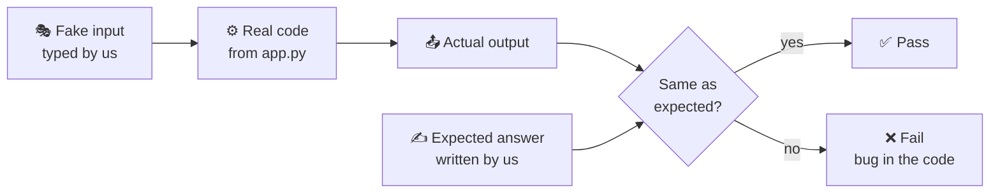
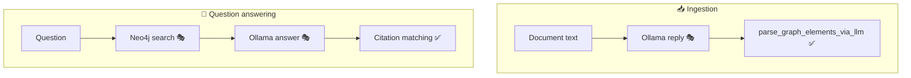

# 🧪 Tests for the GraphRAG Assistant


These tests check the **logic inside `app.py`**: parsing the LLM's JSON, building nodes and edges, matching citations, and handling errors. They use fake versions of Ollama and Neo4j, so they need **no Docker, no model download and no database**. The whole suite runs in a couple of seconds.

**Jump to:** [Run](#-run-the-tests) · [How it works](#-how-a-test-works) · [The 6 tests](#-the-6-tests) · [Try breaking one](#-try-breaking-a-test) · [Limits](#-what-is-not-covered)

---

## ▶️ Run the tests

```bash
pip install pytest
pytest -v
```

> 📍 Run this from the project root (`graph-rag/`) so that `import app` can find `app.py`.

Run a single file:

```bash
pytest tests/test_citations.py -v
```

## 📁 Folder layout

```
graph-rag/
├── app.py
├── requirements.txt
└── tests/
    ├── test_app.py                 ← parse a node
    ├── test_parse_edges.py         ← parse nodes + edges
    ├── test_extraction_failure.py  ← Ollama fails during ingestion
    ├── test_no_match.py            ← nothing found in the graph
    ├── test_citations.py           ← valid citations become sources
    └── test_answer_failure.py      ← Ollama fails while answering
```

One file per topic, so the file name tells you what is being tested.

---

## 💡 How a test works

Every test follows the same three steps:

1. **Arrange:** create a fake input
2. **Act:** run the real function from `app.py`
3. **Assert:** compare the real output with the answer we expect



### Why fake the input?

Ollama's real reply is slightly different on every run, and it needs setup. So we can't write down a "correct answer" in advance. When we type the reply ourselves, the correct answer is known, and the test can check that our code produces it.

### What is fake and what is real?

| | What |
|---|---|
| 🎭 Fake | Ollama's reply, the Neo4j store, and `st.warning` |
| ⚙️ Real | The code in `app.py`: parsing, citation matching, error handling |
| ✍️ Written by us | The expected values inside each `assert` |

### Where the fakes plug in



🎭 = replaced by a fake  ·  ✅ = real code under test

### How the swap is done

**Fake Ollama** with pytest's `monkeypatch`. For the length of one test, it replaces `chat` with our own function:

```python
def fake_chat(**kwargs):
    return {"message": {"content": '{"nodes":[...],"edges":[...]}'}}

monkeypatch.setattr(app.inference_client, "chat", fake_chat)
```

**Fake Neo4j** with a tiny class that has only the methods the function calls:

```python
class FakeStore:
    def query_nodes_by_text(self, text_query):
        return [{"name": "Ada"}]

    def fetch_hops_context(self, start_node, depth=2):
        return [{"name": "Acme", "summary": "A company",
                 "source": "sample.txt", "chunk": "Ada works at Acme.",
                 "path_contexts": ["Ada works at Acme"]}]
```

pytest undoes every `monkeypatch` change when the test ends, so tests never affect each other.

---

## 📋 The 6 tests

> ### 1️⃣ Parse a node
> 📄 `test_app.py`
> **Fake:** Ollama reply with one node (Ada)
> **Expect:** 1 node named `Ada`, linked to `sample.txt`, and no edges

> ### 2️⃣ Parse nodes and edges
> 📄 `test_parse_edges.py`
> **Fake:** Ollama reply with 2 nodes (Ada, Acme) and 1 edge (`WORKS_FOR`)
> **Expect:** 2 `GraphNode` objects and 1 `GraphEdge` with source `Ada`, target `Acme`, type `WORKS_FOR`

> ### 3️⃣ Extraction fails
> 📄 `test_extraction_failure.py`
> **Fake:** `chat` raises a `ConnectionError`, like Ollama being offline
> **Expect:** no crash, the result is `([], [])`, and one warning containing the error text

> ### 4️⃣ No match in the graph
> 📄 `test_no_match.py`
> **Fake:** a store that finds nothing
> **Expect:** the "No matching nodes found" message, no sources, and **Ollama is never called**

> ### 5️⃣ Valid citations
> 📄 `test_citations.py`
> **Fake:** one graph match, and an answer citing `[1]` (real) and `[9]` (made up)
> **Expect:** exactly 1 source, with document `sample.txt` and the stored snippet. The fake `[9]` is ignored

> ### 6️⃣ Answer generation fails
> 📄 `test_answer_failure.py`
> **Fake:** retrieval works, then `chat` raises an error
> **Expect:** "An error occurred during text generation", no sources, and the retrieval steps still in the trace

---

## 🔍 Reading the result

When everything passes, pytest prints something like:

```
tests/test_answer_failure.py::test_answer_generation_failure_returns_error_message PASSED
...
====== 6 passed in 1.2s ======
```

When something is wrong, it shows the expected and actual values side by side:

```
assert edges[0].source_node == "Ada"
AssertionError: assert 'Acme' == 'Ada'
```

That tells you which line failed and what the code returned instead.

## 🔨 Try breaking a test

A test you have never seen fail is not proven. To check:

1. In `app.py`, change `source_node=eg['source']` to `source_node=eg['target']`
2. Run `pytest -v`: `test_parse_edges.py` should fail
3. Undo the change and run again: all green

## ➕ Add a new test

1. Create `tests/test_something.py`
2. Fake the input (a `monkeypatch` for Ollama, a small class for Neo4j)
3. Call the real function and `assert` the expected result

Copy any existing file as a starting point.

---

## 🚧 What is not covered

These tests prove that the app's own logic is correct. They do **not** check:

- the Cypher queries inside `Neo4jGraphStore`
- whether real Ollama replies in the format the app expects, or how good its answers are
- the Streamlit interface

Those need **integration tests** that run against real Neo4j and Ollama. Since the model's output varies, they would check loose things like "at least one node came back" rather than exact text.

## 🛠️ Troubleshooting

**`ModuleNotFoundError: No module named 'app'`**
Run `pytest` from the project root. If it still fails, add an empty `conftest.py` file in the root folder.

**`pytest: command not found`**
Install it with `pip install pytest`, or run `python -m pytest -v`.